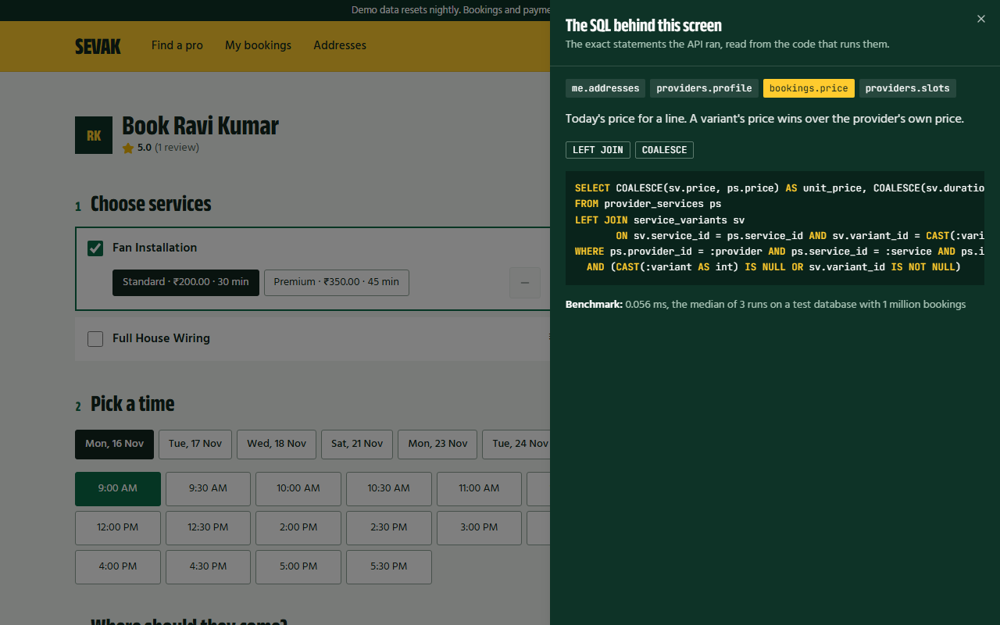
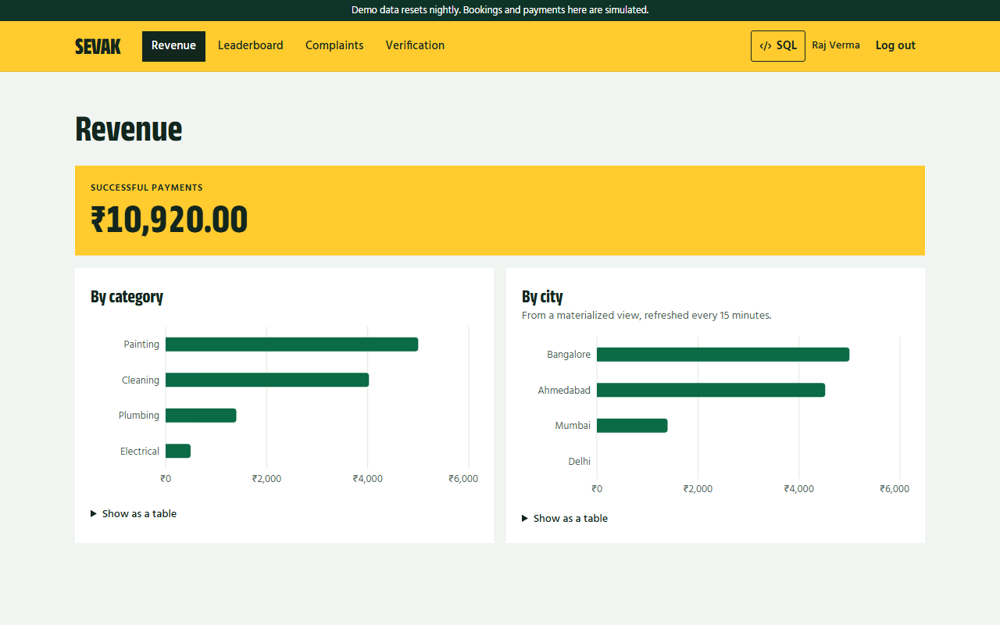
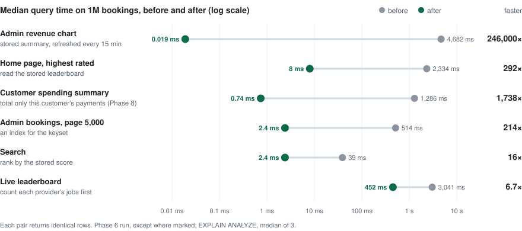
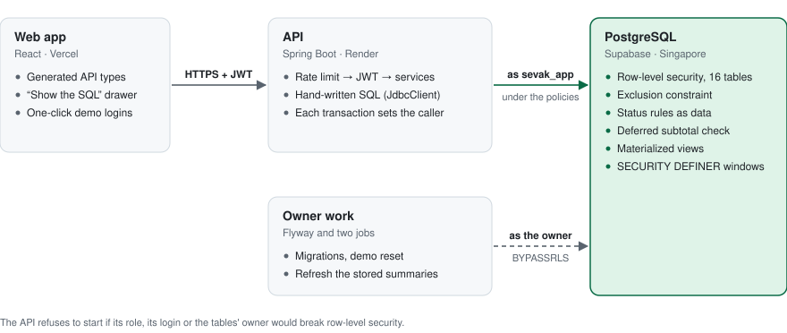
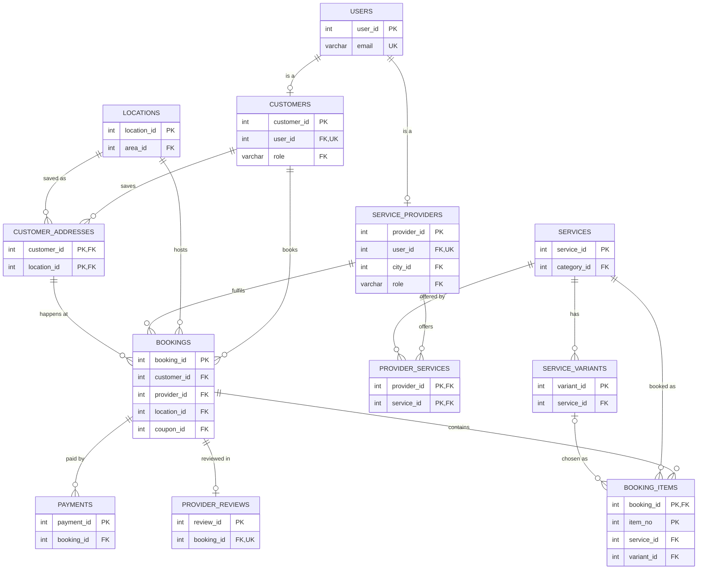

<p align="center">
  <picture>
    <source media="(prefers-color-scheme: dark)" srcset="docs/images/logo-dark.png">
    
  </picture>
</p>

<p align="center">
  <strong>A home-services marketplace where the database enforces the business rules.</strong><br>
  Customers book electricians, plumbers and cleaners, providers run the jobs, admins watch the money.<br>
  PostgreSQL, Spring Boot and React, and every number here links to how it was measured.
</p>

<p align="center">
  <a href="https://github.com/madhavthesiya/sevak/actions/workflows/ci.yml"></a>
  <a href="https://github.com/madhavthesiya/sevak/releases"></a>
  <a href="https://sevak-tau.vercel.app"></a>
  <a href="LICENSE"></a>
</p>

<p align="center">
  <a href="https://sevak-tau.vercel.app"><b>Live demo</b></a> &nbsp;·&nbsp;
  <a href="#quick-start">Quick start</a> &nbsp;·&nbsp;
  <a href="#inside">Inside</a> &nbsp;·&nbsp;
  <a href="#results">Results</a> &nbsp;·&nbsp;
  <a href="#how-it-works">How it works</a> &nbsp;·&nbsp;
  <a href="#what-the-database-guarantees">Guarantees</a> &nbsp;·&nbsp;
  <a href="#documentation">Documentation</a>
</p>

<p align="center">
  <picture>
    <source media="(prefers-color-scheme: dark)" srcset="docs/assets/stats-dark.svg">
    
  </picture>
</p>

It started as a DBMS course project: a normalised 23-table schema with good SQL and no safety net. Auditing it like a production system found revenue counted twice, seed data that contradicted itself, no login and a dead demo. It was rebuilt in ten phases: the database now refuses double bookings, illegal status changes and drifting totals, keeps each user's rows private, and was benchmarked on a million bookings.

| Booking with a live price | The SQL behind every screen | Admin revenue |
|:---:|:---:|:---:|
|  |  |  |

> [!NOTE]
> **Try it:** open the [live demo](https://sevak-tau.vercel.app) and click **Customer**, **Provider** or **Admin** to log in as a demo account. It runs on free plans, so after a quiet spell the first request can take about two minutes while the API starts. The demo data resets every night at 03:00 IST.

## Inside

<table>
  <tr>
    <td width="50%" valign="top">
      <b>Double booking is impossible, not unlikely</b><br>
      A GiST exclusion constraint refuses two active bookings whose time ranges overlap for one provider. Two simultaneous requests: exactly one wins. Under load, 216 attempts were refused with <code>409 slot-taken</code>. <a href="docs/adr/0003-exclusion-constraint-for-double-booking.md">Why</a>
    </td>
    <td width="50%" valign="top">
      <b>Privacy enforced by the database</b><br>
      Requests run as <code>sevak_app</code> under row-level security on 16 tables, so a query that forgets its <code>WHERE customer_id = ...</code> returns nothing, not someone else's rows. The API won't start if its login could skip the policies. <a href="docs/adr/0008-row-level-security.md">How</a>
    </td>
  </tr>
  <tr>
    <td valign="top">
      <b>Status rules are data</b><br>
      The allowed moves (pending → confirmed → in progress → completed) are rows in a table. A trigger refuses the rest, and another logs every change, which the API's own role can't forge. <a href="#what-the-database-guarantees">Guarantees</a>
    </td>
    <td valign="top">
      <b>Money that can't drift</b><br>
      A deferred trigger checks at commit that a booking's subtotal equals its items, and that it has at least one; <code>total = subtotal − discount</code> is a <code>CHECK</code>. A revenue bug that counted payments twice was found and proven. <a href="docs/adr/0002-enforce-business-rules-in-the-database.md">Why in the database</a>
    </td>
  </tr>
  <tr>
    <td valign="top">
      <b>Races, tested for real</b><br>
      Cancel against accept, the last coupon, and a retried request all race in the tests. The tests also found a deadlock between two bookings for one provider, fixed with a per-provider advisory lock. <a href="api/src/test/java/com/sevak/api/ApiConcurrencyTest.java">Tests</a>
    </td>
    <td valign="top">
      <b>Measured on a million bookings</b><br>
      <code>EXPLAIN ANALYZE</code>, median of three, and every rewrite proven to return identical rows. It found three pages a small database had hidden, and one rewrite that only looked faster. <a href="docs/BENCHMARKS.md">Benchmarks</a>
    </td>
  </tr>
  <tr>
    <td valign="top">
      <b>“Show the SQL” on every screen</b><br>
      Each response names the query behind it. The drawer shows that SQL, the techniques it uses and its measured time, and admins can run <code>EXPLAIN ANALYZE</code> on allow-listed queries. <a href="docs/images/sql-drawer.png">Screenshot</a>
    </td>
    <td valign="top">
      <b>Docs that can't go out of date</b><br>
      The schema diagrams, the relational schema and the diagram below are generated from the database the migrations build, and CI fails if any of them drifts. <a href="docs/schema/README.md">Schema docs</a>
    </td>
  </tr>
</table>

> [!TIP]
> **If you read one page:** [ADR 0008, row-level security](docs/adr/0008-row-level-security.md): why the API can't read another user's rows, what measuring it found, and what a review caught that the tests had missed.

## Quick start

The fastest way is the [live demo](https://sevak-tau.vercel.app). To run it yourself you need only Docker:

```bash
git clone https://github.com/madhavthesiya/sevak.git && cd sevak
docker compose up --build
```

| Open | At |
|---|---|
| Web app | <http://localhost:5173> |
| API docs (Swagger UI) | <http://localhost:8080/swagger-ui.html> |
| Health | <http://localhost:8080/actuator/health/readiness> |

Flyway builds the schema, creates the `sevak_app` role and loads the demo data on first start. Every demo account uses the password `Demo@1234`: customer `aarav.sharma@gmail.com`, provider `ravi.electrician@gmail.com`, admin `admin.raj@sevak.com`.

<details>
<summary><b>Developing without Docker for the app</b></summary>
<br>

```bash
docker compose up -d db                                   # just PostgreSQL
cd api && ./mvnw spring-boot:run                          # API on :8080 (Java 21)
cd web && cp .env.example .env && npm ci && npm run dev   # web app on :5173 (Node 24)
```

After changing the API, run `npm run api:sync` in `web/` to regenerate the TypeScript types.

</details>

## Results

<picture>
  <source media="(prefers-color-scheme: dark)" srcset="docs/assets/results-dark.svg">
  
</picture>

<details>
<summary><b>The numbers behind the chart</b></summary>
<br>

| Query | Before, ms | After, ms | What changed |
|---|---:|---:|---|
| Admin revenue chart | 4,682 | 0.019 | A stored summary, refreshed every 15 minutes ([ADR 0004](docs/adr/0004-materialized-views-for-dashboards.md)) |
| Home page, highest rated | 2,334 | 8.0 | Read the stored leaderboard |
| Customer spending summary | 1,286 | 0.74 | Total only this customer's payments (found in Phase 8) |
| Admin bookings, page 5,000 | 514 | 2.4 | An index for the keyset ([ADR 0006](docs/adr/0006-offset-vs-keyset-pagination.md)) |
| Search | 39.0 | 2.4 | Rank by the stored score instead of averaging 441,461 reviews per search |
| Live leaderboard | 3,041 | 452 | Count each provider's jobs first, instead of `COUNT(DISTINCT)` |

Median of three `EXPLAIN (ANALYZE, BUFFERS)` runs after a warm-up, on one laptop.

</details>

**How it was measured.** A generated dataset of 1,000,010 bookings with every constraint on, the app's own SQL read from the repositories, and each "before" variant run inside a rolled-back transaction against the same data. A rewrite counts only if it returns exactly the same rows as the query it replaced.

**What it costs.**
- Row-level security adds 0.3 to 0.8 ms to a private page.
- The stored summaries can be up to 15 minutes old.
- One rewrite was *slower* on a quiet machine though faster on noisy ones, and was reverted. [Experiment 6](docs/BENCHMARKS.md#6-revenue-by-category-correctness-a-rewrite-that-failed-and-a-stored-summary)

[Every experiment, query plan and the load test](docs/BENCHMARKS.md)

## How it works

<picture>
  <source media="(prefers-color-scheme: dark)" srcset="docs/assets/architecture-dark.svg">
  
</picture>

The API writes its own SQL with `JdbcClient`, so the SQL drawer shows exactly what runs ([ADR 0001](docs/adr/0001-raw-sql-with-jdbcclient-over-jpa.md)). Java checks a rule first to give a friendly error, and the database enforces it again so it holds on every code path and during races ([ADR 0002](docs/adr/0002-enforce-business-rules-in-the-database.md)). Short atomic steps such as cancel and accept are stored procedures that lock the row; creating a booking is a Java transaction ([ADR 0005](docs/adr/0005-stored-procedures-vs-service-layer.md)). Logins are one 24-hour JWT ([ADR 0007](docs/adr/0007-jwt-authentication.md)), and the frontend's types are generated from the API's OpenAPI document, so CI fails if they drift.

## What the database guarantees

| Rule | Enforced by | Tested in |
|---|---|---|
| A provider is never double-booked | An exclusion constraint on `(provider_id, tstzrange)` over active bookings | [BookingConcurrencyTest](api/src/test/java/com/sevak/api/BookingConcurrencyTest.java), [ApiConcurrencyTest](api/src/test/java/com/sevak/api/ApiConcurrencyTest.java) |
| A booking moves only along allowed statuses | The `booking_status_transitions` table and a trigger | [DatabaseConstraintsTest](api/src/test/java/com/sevak/api/DatabaseConstraintsTest.java) |
| Every status change is logged, with who made it | A trigger only the database can run; the API can't write the log | [DatabaseTriggersTest](api/src/test/java/com/sevak/api/DatabaseTriggersTest.java) |
| A booking has items, its subtotal equals them, and the total is subtotal minus discount | A deferred trigger checked at commit, and a `CHECK` | [DatabaseConstraintsTest](api/src/test/java/com/sevak/api/DatabaseConstraintsTest.java) |
| Cancel and accept can't corrupt each other | Row locks in the procedures, plus the status trigger | [BookingConcurrencyTest](api/src/test/java/com/sevak/api/BookingConcurrencyTest.java) |
| The last coupon goes to one customer, and each customer uses it once | An atomic claim and a primary key | [ApiConcurrencyTest](api/src/test/java/com/sevak/api/ApiConcurrencyTest.java) |
| A retried request creates one booking | The `idempotency_keys` table | [ApiConcurrencyTest](api/src/test/java/com/sevak/api/ApiConcurrencyTest.java) |
| A user is only one kind of account | Composite foreign keys on `(user_id, role)` | [DatabaseConstraintsTest](api/src/test/java/com/sevak/api/DatabaseConstraintsTest.java) |
| You see and change only your own rows | Row-level security on 16 tables, as `sevak_app` | [RowLevelSecurityTest](api/src/test/java/com/sevak/api/RowLevelSecurityTest.java): with the policies off, 17 of its 29 tests fail |

## Data model

<!-- schema:mermaid:start -->

<!-- schema:mermaid:end -->

The 12 central tables of 29. This diagram, like every schema document here, is generated from the database the migrations build.

[Physical diagram](docs/schema/sevak-schema.svg) &nbsp;·&nbsp; [Relational schema](docs/schema/RELATIONAL_SCHEMA.md) &nbsp;·&nbsp; [Conceptual ER diagram](docs/schema/conceptual-er.svg) &nbsp;·&nbsp; [Normalization proof (BCNF)](docs/SEVAK_Normalization_Proof.md)

## API

Everything is under `/api/v1`, documented in the [live Swagger UI](https://sevak-api.onrender.com/swagger-ui.html). Lists return `{ data, page, limit, total, totalPages }`, and errors are [RFC 9457 Problem Details](https://www.rfc-editor.org/rfc/rfc9457) with a stable `type`.

```bash
API=https://sevak-api.onrender.com   # or http://localhost:8080

# Log in as the demo customer
TOKEN=$(curl -s -X POST $API/api/v1/auth/login \
  -H 'Content-Type: application/json' \
  -d '{"email":"aarav.sharma@gmail.com","password":"Demo@1234"}' \
  | sed 's/.*"accessToken":"\([^"]*\)".*/\1/')

# Price a job with a coupon, without using the coupon up
curl -s -X POST $API/api/v1/bookings/quote \
  -H "Authorization: Bearer $TOKEN" -H 'Content-Type: application/json' \
  -d '{"providerId":1,"couponCode":"NEWUSER25","items":[{"serviceId":2,"quantity":1}]}'
# {"subtotal":2600.00,"discount":650.00,"totalAmount":1950.00,"minutes":60,...}

# Someone else's booking looks like it doesn't exist
curl -s -o /dev/null -w '%{http_code}\n' -H "Authorization: Bearer $TOKEN" \
  $API/api/v1/me/bookings/999999
# 404
```

<details>
<summary><b>All endpoints</b></summary>
<br>

| Area | Endpoints |
|---|---|
| Public | `GET /services`, `/areas`, `/providers` (search), `/providers/top`, `/providers/{id}`, `/providers/{id}/reviews`, `/providers/{id}/slots` |
| Auth | `POST /auth/register`, `/auth/login` (a 24-hour JWT); `GET /me` |
| Customer | `GET /me/bookings`, `/me/bookings/{id}`, `/me/payments`, `/me/spending`; `GET` `POST` `DELETE` `/me/addresses` |
| Bookings | `POST /bookings/quote`, `/bookings` (supports `Idempotency-Key`), `/bookings/{id}/accept`, `/decline`, `/start`, `/complete`, `/cancel`, `/payments`, `/review`, `/complaints` |
| Provider | `GET /provider/jobs`, `/provider/earnings`, `/provider/earnings/monthly`, `/provider/profile`; `GET` `POST` `DELETE` `/provider/availability`, `/provider/services` |
| Admin | `GET /admin/revenue`, `/admin/city-revenue`, `/admin/leaderboard`, `/admin/complaints`, `/admin/complaints/board`, `/admin/providers`, `/admin/bookings` (keyset); `PATCH /admin/providers/{id}/verification`, `/admin/complaints/{id}`; `POST /admin/refunds/{id}/process`, `/admin/refresh-views`, `/admin/queries/{key}/explain` |
| Meta | `GET /meta/queries/{key}`: the SQL behind a screen, named in each response's `X-Sevak-Query` header |
| Health | `/actuator/health/readiness` (`503` when the database is down), `/actuator/health/liveness`, `/actuator/info`, `/actuator/metrics` |

Every response carries an `X-Request-Id`, which also appears on the matching log lines.

</details>

<details>
<summary><b>Error catalogue</b></summary>
<br>

| Status | `type` (after `urn:sevak:error:`) | When |
|:--|:--|:--|
| 400 | `validation-error` | Invalid parameter or body |
| 401 | `unauthenticated` | Missing, expired or invalid login token |
| 403 | `forbidden` | Your role can't do this |
| 404 | `not-found` | Unknown URL, or a resource that doesn't exist or isn't yours |
| 405 | `method-not-allowed` | Wrong HTTP method |
| 409 | `invalid-state` | The booking's status doesn't allow this action |
| 409 | `slot-taken` | Someone else just booked that time |
| 409 | `idempotency-conflict` | An `Idempotency-Key` was reused for a different request |
| 409 | `slot-overlap` | New working hours overlap existing ones |
| 422 | `business-rule` | A business rule was broken, such as the provider not covering that area |
| 422 | `coupon-invalid` | Coupon expired, used up, already used by you, or below its minimum |
| 429 | `rate-limited` | Too many requests; see `Retry-After` |
| 500 | `internal` | Unexpected error; details only in the server log |

</details>

## Testing

| Suite | What it covers | Run it |
|---|---|---|
| **Backend**, 271 tests | Every endpoint and error; security and ownership; row-level security as the API's own role; every constraint and trigger; the procedures; revenue correctness; real concurrent requests. Against a real PostgreSQL 16 built by Flyway (Testcontainers); each test rolls back | `cd api && ./mvnw verify` |
| **Web unit**, 31 tests | Money in Indian digit grouping and dates in India time, form validation, and a safe post-login redirect | `cd web && npm test` |
| **End to end**, 14 journeys | A real browser against the real API: book, accept, a coupon reprices the bill, overlapping hours are refused, a full booking at phone width | `cd web && npx playwright test` |
| **Schema docs** | Fails if any diagram or schema document no longer matches the database | part of `./mvnw verify` |
| **Production smoke test**, 23 checks | The live site end to end: health, demo logins, a booking from request to review, admin pages, 401/403/404, CORS | `node scripts/smoke-test.mjs <api> <web>` |
| **Benchmarks** | Ten experiments on 1M bookings | [BENCHMARKS.md](docs/BENCHMARKS.md) |

CI runs the backend, web and end-to-end suites on every push, with a formatting check and a check that the generated API types are current. Line coverage was 96.5% on 14 Nov 2026.

## How it grew

| When | Release | What changed |
|---|---|---|
| Mar–Apr 2026 | | The DBMS course project: 23 tables in BCNF, 21 endpoints, good SQL, almost no safety net |
| Nov 2026 | 1.1.0 | Emergency fixes: revenue counted twice, contradictory seed data, a health check that lied |
| | 1.2.0 | Flyway migrations, Testcontainers, CI |
| | 2.0.0-db | The database enforces the rules: double booking, status changes, money |
| | 2.1.0, 2.2.0 | A typed, versioned API; login, roles and the full booking lifecycle, tested under concurrency |
| | 2.3.0 | The React app and the "Show the SQL" drawer |
| | 2.4.0 | Benchmarks on a million bookings |
| | 3.0.0 | Generated diagrams, architecture decisions, this README |
| | 3.1.0 | Row-level security |
| | 3.2.0 | Live on Supabase, Render and Vercel |

[Every change, release by release](CHANGELOG.md)

## Known limits

| Limit | What I'd do next |
|---|---|
| The demo runs on free plans: after an idle spell the API takes about two minutes to start | A keep-alive ping every 10 minutes; an always-on instance would remove the wait |
| Payments are mocked | A real gateway with signed webhooks |
| A banned user's token works for up to 24 hours | Short-lived tokens with refresh, or a denylist |
| The login token is readable by scripts on the page | An `HttpOnly` cookie with CSRF protection |
| Search filters by city, so it can list providers who don't cover the customer's area | Filter by the logged-in customer's area |
| Row-level security guards against bugs, not SQL injection | Every query is parameterised; RLS is the second line |
| Rate limits are counted per server | Shared counters if there is more than one server |
| Address coordinates are placeholders | A geocoding service |
| Benchmarks ran on one laptop with generated data | Measure again on the live servers |

## Documentation

| Page | Read it for |
|---|---|
| [Architecture decisions](docs/adr/README.md) | Eight short records: why raw SQL, why rules in the database, the exclusion constraint, row-level security and more |
| [Benchmarks](docs/BENCHMARKS.md) | Every experiment on 1M bookings, the query plans and the load test |
| [Schema](docs/schema/README.md) | The generated diagrams and relational schema, the conceptual model and how CI keeps them honest |
| [Normalization proof](docs/SEVAK_Normalization_Proof.md) | Why every table is in BCNF, and which derived values are kept on purpose |
| [Deployment](docs/DEPLOYMENT.md) | Supabase, Render and Vercel, step by step, and the smoke test |
| [Changelog](CHANGELOG.md) | Every release |

### Built with

| Layer | Tools |
|---|---|
| Backend | Java 21, Spring Boot 4, Spring JDBC (`JdbcClient`), Spring Security with JWT, Bucket4j, springdoc-openapi |
| Database | PostgreSQL 16 and 17, with `btree_gist` and `pg_trgm`; Flyway |
| Frontend | React, TypeScript, Vite, TanStack Query, openapi-fetch, Tailwind CSS, shadcn/ui, Recharts |
| Testing | JUnit 5, Testcontainers, MockMvc, JaCoCo, Vitest, Playwright, k6 |
| Delivery | Docker, GitHub Actions; Supabase, Render and Vercel |

<br>

<p align="center">
  <sub>Sevak (सेवक) is Hindi for “one who serves”.<br>
  Made by <a href="https://www.linkedin.com/in/madhavthesiya/">Madhav Thesiya</a> &nbsp;·&nbsp; © 2026, all rights reserved, see <a href="LICENSE">LICENSE</a></sub>
</p>
