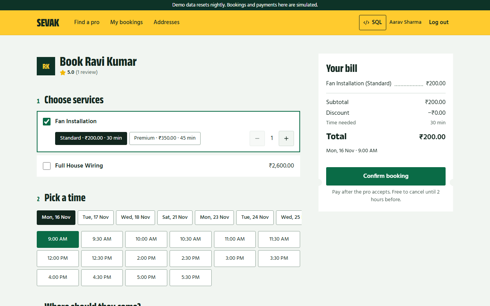
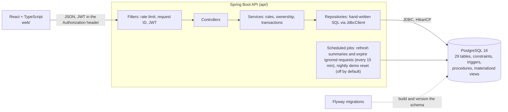
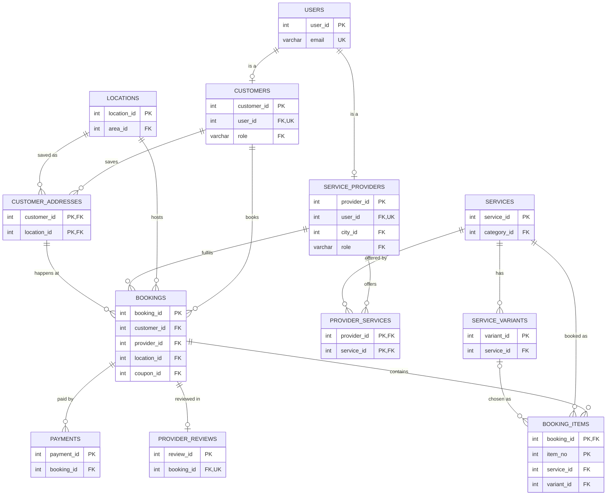

<div align="center">

# SEVAK

**A home-services marketplace where the database enforces the business rules.**

Customers book electricians, plumbers and cleaners; providers accept and complete jobs; admins verify providers and watch revenue. Built on a 29-table PostgreSQL schema in BCNF, a Spring Boot API that writes its own SQL, and a React app that can show the SQL behind every screen.

[](https://github.com/madhavthesiya/sevak/actions/workflows/ci.yml)


</div>

---

## Demo

| Booking with a live price | The SQL behind the screen | Admin revenue |
|---|---|---|
|  |  |  |

**Try it:** `docker compose up --build`, open <http://localhost:5173> and click **Customer**, **Provider** or **Admin** on the home page to log in as a demo account. The hosted demo is offline until the project's final deployment.

## What it does

| Role | Can |
|---|---|
| **Customer** | Search providers by service, city and day; see only times that can really be booked; get a live price with a coupon; book; pay (mock gateway); cancel until 2 hours before; review after the job; manage saved addresses |
| **Provider** | Accept or decline requests, start and complete jobs; set working hours and the services they offer, with their own prices; see earnings by month and payment method, and their reviews. A street address is shown only after accepting |
| **Admin** | Revenue by category and city, the provider leaderboard, the complaints board and the provider verification queue |
| **Everyone** | A **"Show the SQL"** drawer on every screen with the exact query behind it; admins can run an allow-listed `EXPLAIN ANALYZE` |

## Architecture



- The frontend's TypeScript types are generated from the API's OpenAPI document, and CI fails if they drift.
- Every rule that the schema can express lives in the database, with Java checking first to give friendly errors ([ADR 0002](docs/adr/0002-enforce-business-rules-in-the-database.md)).

## Data model

<!-- schema:mermaid:start -->

<!-- schema:mermaid:end -->

The 12 central tables with their key columns. This diagram, like every schema document in the repo, is **generated from the database the migrations build**, and a test fails the build if any of them drifts.

- [Full physical diagram](docs/schema/sevak-schema.svg): all 29 tables, coloured by domain
- [Relational schema](docs/schema/RELATIONAL_SCHEMA.md): every key, CHECK, exclusion constraint, index and trigger
- [Conceptual ER model](docs/schema/CONCEPTUAL_MODEL.md): entities, relationships and cardinalities
- [Normalization proof](docs/SEVAK_Normalization_Proof.md): why every table is in BCNF, and which derived values are kept on purpose

## Engineering highlights

**1. Double booking is impossible, not just unlikely.**
*Problem:* checking "is this slot free?" in Java and then inserting races; two requests can both see the slot free.
*Solution:* a GiST exclusion constraint: no two active bookings for one provider may have overlapping `tstzrange`s. Cancelled bookings free the slot.
*Proof:* concurrent tests send two requests for the same slot and check exactly one wins ([`BookingConcurrencyTest`](api/src/test/java/com/sevak/api/BookingConcurrencyTest.java), [`ApiConcurrencyTest`](api/src/test/java/com/sevak/api/ApiConcurrencyTest.java)); in the load test, 216 attempts were correctly refused with `409 slot-taken`. [ADR 0003](docs/adr/0003-exclusion-constraint-for-double-booking.md)

**2. Cancel and confirm can't corrupt each other.**
*Problem:* the procedures read the status, then updated it, so a confirm racing a cancel could leave a confirmed booking with a refund.
*Solution:* `SELECT ... FOR UPDATE` in `sp_cancel_booking` and `sp_confirm_booking`, plus the status trigger below.
*Proof:* `cancelAndConfirmAtTheSameTimeLeaveAConsistentBooking` runs them concurrently. Removing only the lock, or only the trigger, still passed; removing both failed, so each protects on its own. [ADR 0005](docs/adr/0005-stored-procedures-vs-service-layer.md)

**3. Booking status rules are data.**
*Problem:* any status could change to any other, such as `completed` back to `pending`.
*Solution:* the allowed moves are rows in `booking_status_transitions`; a trigger rejects anything else, and another writes every change to an audit log.
*Proof:* [`DatabaseConstraintsTest.anIllegalStatusChangeIsRejected`](api/src/test/java/com/sevak/api/DatabaseConstraintsTest.java), and [`DatabaseTriggersTest`](api/src/test/java/com/sevak/api/DatabaseTriggersTest.java) for the log, including two changes in one transaction.

**4. A revenue bug I found in my own code.**
*Problem:* revenue by category joined payments to booking items, so a booking with two items counted its payment twice. On the demo data it reported ₹11,010 instead of ₹8,005, 37% too high. `COUNT(DISTINCT)` looked right, which hid it.
*Solution:* total each booking's items per category first, then split each payment in proportion with a window function, which also handles bookings that span categories.
*Proof:* [`DataCorrectnessTest`](api/src/test/java/com/sevak/api/DataCorrectnessTest.java) checks category revenue adds up to total payments, and covers a two-category booking.

**5. Stored summaries where live queries were too slow.**
*Problem:* on 1M bookings the revenue chart took 4.7 s against a 5-second query limit, and the home page's top providers 2.3 s.
*Solution:* materialized views refreshed every 15 minutes, under an advisory lock so only one app instance refreshes. The trade-off is up to 15 minutes of staleness.
*Proof:* 4,682 ms → 0.019 ms and 2,334 ms → 8.0 ms, and tests check that the stored category revenue and leaderboard equal their live queries. [ADR 0004](docs/adr/0004-materialized-views-for-dashboards.md)

**6. BCNF, with redundancy only on purpose.**
*Problem:* the original `addresses` table had `{latitude, longitude} → street, area`, where the coordinates weren't a key.
*Solution:* split into `locations` (coordinates are a candidate key) and `customer_addresses` (`label` and `house_no` depend on the customer and the location together). The few derived values kept for speed (`avg_rating`, `subtotal`, `total_amount`, `used_count`) are each kept correct by a trigger or a CHECK.
*Proof:* the [normalization proof](docs/SEVAK_Normalization_Proof.md), and rating-trigger and subtotal tests.

Also: `Idempotency-Key` makes a retried booking return the first result; the last use of a coupon goes to exactly one of two concurrent customers; one user can't read another's data (`/me` routes, and `404` instead of `403` for other people's IDs).

## Benchmarks

Measured with `EXPLAIN (ANALYZE, BUFFERS)` on about **1 million bookings**, with every rewrite checked to return exactly the same rows as the query it replaced:

| What | Before | After | How |
|---|---:|---:|---|
| Home page "highest rated" | 2,334 ms | 8.0 ms | Read the stored leaderboard |
| Admin bookings, page 5,000 | 514 ms | 2.4 ms | An index on the keyset's sort columns ([ADR 0006](docs/adr/0006-offset-vs-keyset-pagination.md)) |
| Admin revenue chart | 4,682 ms | 0.019 ms | Stored summary, refreshed every 15 minutes |

Method, all eight experiments, query plans and a k6 load test: [BENCHMARKS.md](docs/BENCHMARKS.md). All numbers come from one laptop.

## API

Swagger UI is at <http://localhost:8080/swagger-ui.html> once the API is running. Everything is under `/api/v1`; lists return `{ data, page, limit, total, totalPages }`.

```bash
# 1. Log in as the demo customer (every demo account uses Demo@1234)
TOKEN=$(curl -s -X POST localhost:8080/api/v1/auth/login -H 'Content-Type: application/json' \
  -d '{"email":"aarav.sharma@gmail.com","password":"Demo@1234"}' | sed 's/.*"accessToken":"\([^"]*\)".*/\1/')

# 2. Price a job with a coupon, without using the coupon up
curl -s -X POST localhost:8080/api/v1/bookings/quote -H "Authorization: Bearer $TOKEN" \
  -H 'Content-Type: application/json' \
  -d '{"providerId":1,"couponCode":"NEWUSER25","items":[{"serviceId":2,"quantity":1}]}'
# {"subtotal":2600.00,"discount":650.00,"totalAmount":1950.00,"minutes":60,"couponCode":"NEWUSER25"}

# 3. Another customer's booking looks like it doesn't exist
curl -s -o /dev/null -w '%{http_code}\n' localhost:8080/api/v1/me/bookings/999999 -H "Authorization: Bearer $TOKEN"
# 404
```

Errors use [RFC 9457 Problem Details](https://www.rfc-editor.org/rfc/rfc9457) with a stable `type`:

| Status | `type` (after `urn:sevak:error:`) | When |
|:--|:--|:--|
| 400 | `validation-error` | Invalid parameter or body |
| 401 | `unauthenticated` | Missing, expired or invalid login token |
| 403 | `forbidden` | Your role can't do this |
| 404 | `not-found` | Unknown URL, or a resource that doesn't exist or isn't yours |
| 405 | `method-not-allowed` | Wrong HTTP method |
| 409 | `invalid-state` | The booking's status doesn't allow this action |
| 409 | `slot-taken` | Someone else just booked that time |
| 409 | `idempotency-conflict` | An `Idempotency-Key` was reused for a different request |
| 409 | `slot-overlap` | New working hours overlap existing ones |
| 422 | `business-rule` | A business rule was broken, such as the provider not covering that area |
| 422 | `coupon-invalid` | Coupon expired, used up, already used by you, or below its minimum |
| 429 | `rate-limited` | Too many requests; see `Retry-After` |
| 500 | `internal` | Unexpected error; details only in the server log |

<details>
<summary><b>All endpoints</b></summary>

| Area | Endpoints |
|---|---|
| Public | `GET /services`, `/areas`, `/providers` (search), `/providers/top`, `/providers/{id}`, `/providers/{id}/reviews`, `/providers/{id}/slots` |
| Auth | `POST /auth/register`, `/auth/login` (a 24-hour JWT); `GET /me` |
| Customer | `GET /me/bookings`, `/me/bookings/{id}`, `/me/payments`, `/me/spending`; `GET` `POST` `DELETE` `/me/addresses` |
| Bookings | `POST /bookings/quote`, `/bookings` (supports `Idempotency-Key`), `/bookings/{id}/accept`, `/decline`, `/start`, `/complete`, `/cancel`, `/payments`, `/review`, `/complaints` |
| Provider | `GET /provider/jobs`, `/provider/earnings`, `/provider/earnings/monthly`, `/provider/profile`; `GET` `POST` `DELETE` `/provider/availability`, `/provider/services` |
| Admin | `GET /admin/revenue`, `/admin/city-revenue`, `/admin/leaderboard`, `/admin/complaints`, `/admin/complaints/board`, `/admin/providers`, `/admin/bookings` (keyset); `PATCH /admin/providers/{id}/verification`, `/admin/complaints/{id}`; `POST /admin/refunds/{id}/process`, `/admin/refresh-views`, `/admin/queries/{key}/explain` |
| Meta | `GET /meta/queries/{key}`: the SQL behind a screen, named in each response's `X-Sevak-Query` header |
| Health | `/actuator/health/readiness` (`503` when the database is down), `/actuator/health/liveness`, `/actuator/info`, `/actuator/metrics` |

Every response carries an `X-Request-Id`, which also appears on the matching log lines.

</details>

## Run it locally

Needs only Docker.

```bash
git clone https://github.com/madhavthesiya/sevak.git && cd sevak
docker compose up --build
```

| | |
|---|---|
| Web app | <http://localhost:5173> |
| API docs (Swagger UI) | <http://localhost:8080/swagger-ui.html> |
| Health | <http://localhost:8080/actuator/health/readiness> |

Flyway builds the schema and loads the demo data on first start. Demo accounts (password `Demo@1234`): customer `aarav.sharma@gmail.com`, provider `ravi.electrician@gmail.com`, admin `admin.raj@sevak.com`.

<details>
<summary><b>Developing without Docker for the app</b></summary>

```bash
docker compose up -d db                       # just PostgreSQL
cd api && ./mvnw spring-boot:run              # API on :8080 (Java 21)
cd web && cp .env.example .env && npm ci && npm run dev   # web app on :5173 (Node 24)
```

After changing the API, run `npm run api:sync` in `web/` to regenerate the TypeScript types.

</details>

## Testing

```bash
cd api && ./mvnw verify     # 235 tests; needs Docker
cd web && npm test          # unit tests (Vitest)
cd web && npx playwright test   # end-to-end, against a running API
```

- **Backend:** integration tests against a real PostgreSQL 16 in Docker (Testcontainers), built from scratch by Flyway. Each test rolls back. They cover every endpoint, the error catalogue, security and ownership, every constraint and trigger, the stored procedures, revenue correctness and real concurrent requests. JaCoCo line coverage on 14 Nov 2026: 96.5% overall and 94.1% for the service classes (85.4% of branches); the report is in `api/target/site/jacoco`.
- **Schema docs:** `SchemaDocsTest` fails if any diagram or schema document no longer matches the database.
- **Frontend:** unit tests, and Playwright journeys in a real browser against the real API: a customer books, the provider accepts, a coupon reprices the bill, overlapping hours are refused, and a full booking works at phone width.
- **CI** runs all of it on every push, plus a formatting check and a check that the generated API types are current.
- **Benchmarks** on 1M bookings: `./mvnw test -Dtest=QueryBenchmark -Dsurefire.failIfNoSpecifiedTests=false` (about 15 minutes).

## Design decisions

Seven short [Architecture Decision Records](docs/adr/README.md): [raw SQL over JPA](docs/adr/0001-raw-sql-with-jdbcclient-over-jpa.md) · [rules in the database](docs/adr/0002-enforce-business-rules-in-the-database.md) · [exclusion constraint](docs/adr/0003-exclusion-constraint-for-double-booking.md) · [materialized views](docs/adr/0004-materialized-views-for-dashboards.md) · [procedures vs services](docs/adr/0005-stored-procedures-vs-service-layer.md) · [OFFSET vs keyset](docs/adr/0006-offset-vs-keyset-pagination.md) · [JWT](docs/adr/0007-jwt-authentication.md)

## Tech stack

| Layer | Choice |
|---|---|
| Backend | Java 21, Spring Boot 4, Spring JDBC (`JdbcClient`), Spring Security with JWT, Bucket4j rate limits, springdoc-openapi |
| Database | PostgreSQL 16 with `btree_gist` and `pg_trgm`, Flyway migrations |
| Frontend | React, TypeScript, Vite, TanStack Query, openapi-fetch, Tailwind CSS, shadcn/ui, Recharts |
| Testing | JUnit 5, Testcontainers, MockMvc, JaCoCo, Vitest, Playwright, k6 |
| Delivery | Docker Compose, GitHub Actions |

## Project layout

```
api/        Spring Boot API, packaged by feature (auth, catalog, provider, customer, booking, admin)
  src/main/resources/db/   Flyway: migration/ (schema, procedures, views) and seed/ (demo data)
  src/test/                Integration, concurrency and schema-doc tests; the benchmark
  sql/                     Showcase queries, data integrity checks, the 1M-booking generator
web/        React app: pages per role, generated API types, the "Show the SQL" drawer, Playwright tests
docs/       Schema diagrams, ADRs, benchmarks, normalization proof
```

## Known limitations and future work

| Limit | What I'd do next |
|---|---|
| The hosted demo is offline | Deploy as the final step of the roadmap |
| Payments are mocked | A real gateway with signed webhooks |
| A banned user's token works for up to 24 hours | Short-lived tokens with refresh, or a denylist |
| The login token is readable by scripts on the page | An `HttpOnly` cookie with CSRF protection |
| Search filters by city, so it can list providers who don't cover the customer's area (found by the load test) | Filter by the logged-in customer's area |
| Rate limits are counted per server | Shared counters if there is more than one server |
| Stored summaries can be 15 minutes old | Fine for analytics; refresh on demand where a page needs fresher data |
| Address coordinates are placeholders | A geocoding service |
| Benchmarks ran on one laptop with generated data | Measure again on real servers after deployment |
| "Every booking has at least one item" is enforced by the API, not the database | A deferred constraint trigger, like the subtotal check |

## Author

**Madhav Thesiya** · [LinkedIn](https://www.linkedin.com/in/madhavthesiya/) · [GitHub](https://github.com/madhavthesiya)

© 2026 Madhav Thesiya. All rights reserved.
