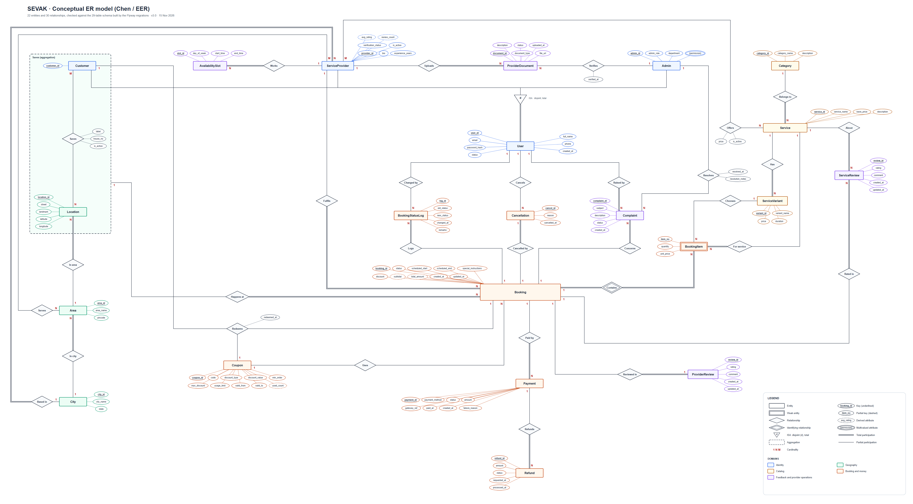

  <a href="../../README.md"><picture>
    <source media="(prefers-color-scheme: dark)" srcset="../images/logo-dark.png">
    
  </picture></a>

  <a href="../adr/README.md">Decisions</a> &nbsp;·&nbsp;
  <a href="../BENCHMARKS.md">Benchmarks</a> &nbsp;·&nbsp;
  <a href="../schema/README.md">Schema</a> &nbsp;·&nbsp;
  <b>Conceptual model</b> &nbsp;·&nbsp;
  <a href="../SEVAK_Normalization_Proof.md">Normalization</a> &nbsp;·&nbsp;
  <a href="../DEPLOYMENT.md">Deployment</a>

# SEVAK: conceptual model (Chen / EER)

This is the conceptual ER model behind the 29 tables. Every entity, attribute, relationship and cardinality below was checked against the generated [relational schema](RELATIONAL_SCHEMA.md), which comes straight from the migrations.

The diagram is also available as an [SVG](conceptual-er.svg) to zoom into and as an editable [draw.io file](conceptual-er.drawio).

**Conventions.** Cardinality is written 1:1, 1:N or M:N. *Total* participation (double line) means every row of that entity takes part, because the foreign key is `NOT NULL` or the row is created with the other side. Foreign keys are never drawn as attributes; the relationship replaces them. Derived attributes (drawn dashed) are values the database keeps in sync for speed; the normalization proof lists them as controlled redundancy.

**Layout of the drawing:** Booking cluster in the centre, Identity top-left, Catalog top-right, Geography bottom-left, Feedback bottom-right, with relationship lines running towards the centre. The [physical diagram](sevak-schema.svg) uses the same five groups and colours.

---

## Entities and attributes

Key attributes are **bold**. *Italic* marks a candidate key that isn't the primary key. (dashed) marks a derived attribute, {braces} a multivalued one.

### Identity (top-left)

| Entity | Type | Attributes | Table |
|---|---|---|---|
| User | Superclass | **user_id**, *email*, password_hash, status, full_name, phone, created_at. `role` is the ISA discriminator, not a separate attribute | `users` |
| Customer | Subclass of User | **customer_id** | `customers` |
| ServiceProvider | Subclass of User | **provider_id**, bio, experience_years, verification_status, is_active, avg_rating (dashed), review_count (dashed) | `service_providers` |
| Admin | Subclass of User | **admin_id**, admin_role, department, {permission} | `admins`, `admin_permissions` |

**ISA: disjoint (d), total.** Disjoint is enforced by the database: each subclass table has a fixed `role` (`CHECK role = 'customer'`, and so on) and a composite foreign key `(user_id, role) → users(user_id, role)`, so a user can only appear in the subclass that matches their role. Total is enforced by the application, not by a constraint: registration inserts the user and the subclass row in one transaction, and every seeded user has exactly one subclass row. Say this precisely in a viva.

`{permission}` is the only multivalued attribute, and it really has its own table (`admin_permissions`, primary key `(admin_id, permission)`).

### Geography (bottom-left)

| Entity | Attributes | Table |
|---|---|---|
| City | **city_id**, city_name, state. *(city_name, state)* | `cities` |
| Area | **area_id**, area_name, pincode | `areas` |
| Location | **location_id**, street, landmark, latitude, longitude. *(latitude, longitude)* | `locations` |

There is **no Address entity**. An address is the M:N relationship **Saves** between Customer and Location (below), which is what fixed the old BCNF violation.

### Catalog (top-right)

| Entity | Attributes | Table |
|---|---|---|
| Category | **category_id**, *category_name*, description | `categories` |
| Service | **service_id**, service_name, base_price, description | `services` |
| ServiceVariant | **variant_id**, variant_name, price, duration. *(service, variant_name)* is unique | `service_variants` |

ServiceVariant is a **strong** entity: it has its own key `variant_id`. Draw it with total participation in **Has**, not as a weak entity.

### Booking (centre)

| Entity | Type | Attributes | Table |
|---|---|---|---|
| Booking | Strong | **booking_id**, status, scheduled_start, scheduled_end, special_instructions, discount, created_at, updated_at, subtotal (dashed), total_amount (dashed) | `bookings` |
| BookingItem | **Weak** (owner: Booking) | **item_no** (partial key, dashed underline), quantity, unit_price | `booking_items` |
| BookingStatusLog | Strong | **log_id**, old_status, new_status, changed_at, remarks | `booking_status_log` |
| Payment | Strong | **payment_id**, payment_method, status, amount, gateway_ref, paid_at, created_at, failure_reason | `payments` |
| Refund | Strong | **refund_id**, amount, status, requested_at, processed_at | `refunds` |
| Cancellation | Strong | **cancel_id**, reason, cancelled_at | `cancellations` |
| Coupon | Strong | **coupon_id**, *code*, discount_type, discount_value, min_order, max_discount, usage_limit, valid_from, valid_to, used_count (dashed) | `coupons` |

BookingItem is the **only weak entity**, in the diagram and in the schema: its primary key is `(booking_id, item_no)` and it is deleted with its booking. `unit_price` is not derived: it is the price at booking time. `discount` is not derived either, because a coupon's terms can change later.

### Feedback (bottom-right)

| Entity | Attributes | Table |
|---|---|---|
| ProviderReview | **review_id**, rating, comment, created_at, updated_at | `provider_reviews` |
| ServiceReview | **review_id**, rating, comment, created_at, updated_at | `service_reviews` |
| Complaint | **complaint_id**, subject, description, status, created_at | `complaints` |
| ProviderDocument | **document_id**, document_type, file_url, description, status, uploaded_at | `provider_documents` |
| AvailabilitySlot | **slot_id**, day_of_week, start_time, end_time | `provider_availability` |

---

## Relationships

"Total" names the side whose participation is total. Every row comes from a foreign key in the schema; the last column names it.

| # | Relationship | Between | Cardinality | Total participation | Attributes | Schema |
|---|---|---|---|---|---|---|
| 1 | **Saves** | Customer – Location | M:N | none | label, house_no, is_active | `customer_addresses` |
| 2 | **Serves** | ServiceProvider – Area | M:N | none | | `provider_service_areas` |
| 3 | **Based in** | ServiceProvider – City | N:1 | ServiceProvider | | `service_providers.city_id` |
| 4 | **In city** | Area – City | N:1 | Area | | `areas.city_id` |
| 5 | **In area** | Location – Area | N:1 | Location | | `locations.area_id` |
| 6 | **Belongs to** | Service – Category | N:1 | Service | | `services.category_id` |
| 7 | **Has** | ServiceVariant – Service | N:1 | ServiceVariant | | `service_variants.service_id` |
| 8 | **Offers** | ServiceProvider – Service | M:N | none | **price**, is_active | `provider_services` |
| 9 | **Happens at** | Booking – (Saves) | N:1 | Booking | | `bookings (customer_id, location_id) → customer_addresses` |
| 10 | **Fulfils** | ServiceProvider – Booking | 1:N | Booking | | `bookings.provider_id` |
| 11 | **Contains** (identifying) | Booking – BookingItem | 1:N | BookingItem; Booking too, see note | | `booking_items.booking_id` |
| 12 | **For service** | BookingItem – Service | N:1 | BookingItem | | `booking_items.service_id` |
| 13 | **Chooses** | BookingItem – ServiceVariant | N:1 | none | | `booking_items.variant_id` (nullable) |
| 14 | **Logs** | Booking – BookingStatusLog | 1:N | BookingStatusLog | | `booking_status_log.booking_id` |
| 15 | **Changed by** | BookingStatusLog – User | N:1 | none | | `booking_status_log.changed_by` (nullable) |
| 16 | **Paid by** | Booking – Payment | 1:N | Payment | | `payments.booking_id` |
| 17 | **Refunds** | Payment – Refund | 1:N | Refund | | `refunds.payment_id` |
| 18 | **Cancelled by** | Booking – Cancellation | 1:1 | Cancellation | | `cancellations.booking_id` (UNIQUE) |
| 19 | **Cancels** | User – Cancellation | 1:N | none | | `cancellations.cancelled_by` (nullable) |
| 20 | **Uses** | Booking – Coupon | N:1 | none | | `bookings.coupon_id` (nullable) |
| 21 | **Redeems** (ternary) | Customer – Coupon – Booking | see note | Booking side: none | redeemed_at | `coupon_redemptions` |
| 22 | **Reviewed in** | Booking – ProviderReview | 1:1 | ProviderReview | | `provider_reviews.booking_id` (UNIQUE) |
| 23 | **Rated in** | Booking – ServiceReview | 1:N | ServiceReview | | `service_reviews.booking_id` |
| 24 | **About** | ServiceReview – Service | N:1 | ServiceReview | | `service_reviews.service_id` |
| 25 | **Concerns** | Booking – Complaint | 1:N | Complaint | | `complaints.booking_id` |
| 26 | **Raised by** | Complaint – User | N:1 | Complaint | | `complaints.raised_by` |
| 27 | **Resolves** | Admin – Complaint | 1:N | none | resolved_at, resolution_notes | `complaints.assigned_admin_id` (nullable) |
| 28 | **Uploads** | ServiceProvider – ProviderDocument | 1:N | ProviderDocument | | `provider_documents.provider_id` |
| 29 | **Verifies** | Admin – ProviderDocument | 1:N | none | verified_at | `provider_documents.verified_by` (nullable) |
| 30 | **Works** | ServiceProvider – AvailabilitySlot | 1:N | AvailabilitySlot | | `provider_availability.provider_id` |

### Notes on the harder ones

- **9, aggregation.** A booking happens at one of *that customer's* saved addresses. Draw **Saves** (Customer – Location) inside a dashed aggregation box and connect **Happens at** from Booking to the box. The schema enforces exactly this with the composite foreign key `(customer_id, location_id) → customer_addresses`, so "which customer booked" and "where" both come through the aggregation. Don't also draw a separate Customer – Booking relationship.
- **11, total participation of Booking.** Every booking has at least one item. The API refuses an empty `items` list, and the database refuses it too: the deferred check that compares a booking's subtotal with its items also rejects a booking with no items, at commit. Until v3.0.0 only the API enforced it; checking this model against the schema found the gap.
- **12 and 13.** When an item names a variant, the variant must belong to the item's service. The composite foreign key `(service_id, variant_id) → service_variants(service_id, variant_id)` enforces it.
- **16 and 17.** A booking can have several payment attempts but only one successful one, and a payment only one refund that hasn't failed. Both are partial unique indexes, so they're constraints on top of the 1:N, not different cardinalities.
- **21, Redeems.** `coupon_redemptions` has primary key `(coupon_id, customer_id)` and `booking_id` is unique, so: a customer redeems a coupon at most once, and each booking redeems at most one coupon. As a ternary relationship, `{Customer, Coupon} → Booking` and `Booking → {Customer, Coupon}`. **Uses** (20) is the booking's own record of its coupon; **Redeems** is what makes "once per customer" a constraint.
- **22–26, feedback connects to Booking.** Reviews and complaints connect to Booking, and the customer and provider are reached through it. Storing them again would be a transitive dependency. Two links are not to people through Booking, and both are needed: ServiceReview – **About** – Service (which service of the booking is rated; a trigger checks it was in the booking), and Complaint – **Raised by** – User, because either the customer or the provider can raise a complaint, so the booking alone can't say who did.
- **27 and 29** carry attributes stored on the N side (`resolved_at`, `resolution_notes`, `verified_at`). For a 1:N relationship that's the usual mapping; drawing them on the diamond is more precise.

### Tables left out of the conceptual model, on purpose

| Table | Why it isn't an entity |
|---|---|
| `booking_status_transitions` | The allowed status changes, stored as rows and checked by a trigger. It's a business rule kept as data, not something the business talks about. Mention it next to Booking.status. |
| `idempotency_keys` | Makes a retried "create booking" request return the first result. A technical table, not part of the domain. |

---

## Roadmap checklist (task 7.1)

| Check | Result |
|---|---|
| No `Address` entity | ✅ Location plus the Saves relationship |
| Reviews and complaints connect only to Booking | ✅ With the two deliberate links explained above (About → Service, Raised by → User) |
| No foreign keys drawn as attributes | ✅ Every foreign key is a relationship in the table above |
| `price` sits on Offers and is stored in `provider_services` | ✅ |
| Multivalued attributes only where a separate table exists | ✅ Only {permission}, stored in `admin_permissions` |
| Weak entities in the diagram are weak in the schema | ✅ Only BookingItem. The schema has no `COMMENT ON` statements, so there are no DDL comments to disagree; the normalization proof gives `booking_items` the key `(booking_id, item_no)` |
| Admin – Resolves – Complaint and Admin – Verifies – ProviderDocument | ✅ Relationships 27 and 29 |
| Derived attributes dashed | ✅ avg_rating, review_count, subtotal, total_amount, used_count (all in section 3 of the proof) |
| One notation, double lines for total participation | Use 1:1 / 1:N / M:N throughout, with the Total column above |
| Aggregation for "a booking happens at a saved address" | ✅ Relationship 9 |
